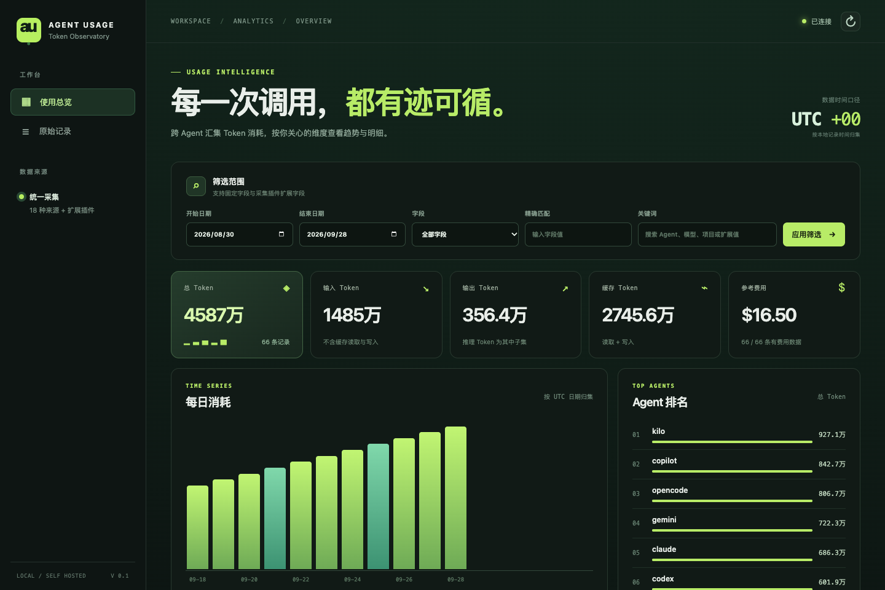

# Agent Usage Hub

把多台机器上的 AI Agent Token 使用量归集到一个页面。一个 npm 包提供两种角色：**collector** 读取本地记录并推送，**server** 幂等入库、查询和展示。

默认 collector 在本项目内直接读取 18 种 Agent 的本地用量记录，来源清单与 [ccusage 20.0.26](https://github.com/ccusage/ccusage) 对齐；本包没有 ccusage 依赖，也不启动 ccusage 进程。其他 AI 应用通过自定义 collector 插件或 JSON/JSONL 事件推送接入。读取器只把用量与指定维度发往 server，不上传会话正文。



## 要求

- Node.js 24 或更新版本（使用内置 SQLite，无需额外数据库服务）。
- collector 所在机器可读取其 Agent 本地使用记录，并可访问 server 的推送接口。

## 一个 npx 包，两种安装角色

项目当前是本地包，尚未发布到 npm。先在项目目录打包，再通过同一个 tarball 运行所有命令：

```bash
npm install
npm pack
npx --yes --package ./agent-usage-hub-0.1.0.tgz agent-usage install server
npx --yes --package ./agent-usage-hub-0.1.0.tgz agent-usage server start
```

server 默认监听 `127.0.0.1:4318`，页面位于 `http://127.0.0.1:4318/`。安装命令创建 `~/.agent-usage-hub/server.json`、权限为 `0600` 的 `admin-token` 和 `push-token` 文件。页面登录使用 `admin-token`；collector 推送使用 `push-token`。命令不会打印 Token。

同机安装 collector：

```bash
npx --yes --package ./agent-usage-hub-0.1.0.tgz agent-usage install collector \
  --server http://127.0.0.1:4318 \
  --token-file ~/.agent-usage-hub/push-token
npx --yes --package ./agent-usage-hub-0.1.0.tgz agent-usage collector once
npx --yes --package ./agent-usage-hub-0.1.0.tgz agent-usage collector watch
```

在另一台机器上，使用 HTTPS 地址和该机器安全提供的环境变量安装 collector：

```bash
npx --yes --package ./agent-usage-hub-0.1.0.tgz agent-usage install collector \
  --server https://usage.example.com --collector-id laptop-01 \
  --token-env AGENT_USAGE_PUSH_TOKEN
AGENT_USAGE_PUSH_TOKEN='<从 server 安全传递的 pushToken>' \
  npx --yes --package ./agent-usage-hub-0.1.0.tgz agent-usage collector watch
```

上面的环境变量仅用于说明接口；实际部署请使用操作系统的密钥注入方式，避免将 Token 写入 shell 历史。server 对外提供服务时，用 TLS 反向代理转发到本机监听地址；如要直接绑定其他网卡，可在安装 server 时传 `--host 0.0.0.0`，并确保接入层启用 HTTPS。collector 默认拒绝向远程明文 HTTP 推送。

包发布到 npm 后，命令可简化为 `npx agent-usage-hub ...`，安装角色和运行参数保持一致。

## 采集行为

- 首次执行 `collector once` 扫描本机所有内置来源；`watch` 默认每 300 秒扫描一次。`collector once --full` 可强制重读未变化的日志。
- 每个本地文件用匿名文件标识分批同步。源文件更新或删除后，对应事件会更新或移除；重复推送不会累加。SQLite 源每次都重读，以便发现 WAL 中的更新。
- `collector.json` 可设置 `sources`、`paths`、`intervalSeconds`、`collectorId`、`extensions` 和 `plugins`。`sources` 默认是全部 18 种来源；例如安装时传 `--sources codex,claude`。`paths` 可按来源指定覆盖目录。静态 `extensions` 会附加到该采集器的所有记录。
- 内置来源：`claude`、`codex`、`opencode`、`amp`、`droid`、`codebuff`、`hermes`、`pi`、`goose`、`kilo`、`copilot`、`gemini`、`antigravity`、`kimi`、`qwen`、`openclaw`、`grok`、`zcode`。具体数据目录和格式见 [来源清单](docs/source-support.md)。
- 旧版 `collector.json` 若仍配置 `sources: ["ccusage"]`，运行时会自动解释为全部内置来源；可以随后手动保存为新的 `sources` 清单。

## 固定字段与扩展字段

每条记录需要稳定的 `eventId`、`source`、`agent`、`occurredAt`。`collectorId` 由 collector 配置提供。固定字段包括 `model`、`project`、`sessionId`、`inputTokens`、`outputTokens`、`cacheReadTokens`、`cacheWriteTokens`、`otherTokens`、`reasoningTokens`、`costUsd`。

`totalTokens = inputTokens + outputTokens + cacheReadTokens + cacheWriteTokens + otherTokens`。`reasoningTokens` 是输出的子集，不再加到总量。`otherTokens` 用于保留源记录提供的总量超出常规四类的 Token。内置 collector 只采用日志中明确提供的费用；缺失费用显示为空，不从模型价格推算。

`extensions` 是扁平 JSON 对象，键只允许字母、数字、下划线和连字符；值可以是字符串、有限数字、布尔值或 `null`。数值型扩展字段可作为求和指标，所有扩展字段均可做精确筛选或分组。服务端 `/api/v1/fields` 会列出可用维度与指标，页面自动展示它们。

### 其他 AI 应用插件

查看 [示例插件](examples/custom-collector.mjs)。在 `~/.agent-usage-hub/collector.json` 中添加：

```json
{
  "plugins": [
    {
      "path": "/absolute/path/custom-collector.mjs",
      "config": { "file": "/absolute/path/usage.jsonl" }
    }
  ],
  "extensions": { "environment": "development" }
}
```

插件默认导出同步或异步可迭代函数，逐条产出事件。使用来自源系统的稳定 ID；重复扫描会更新同一条记录。对于已有导出文件，也可执行 `agent-usage collector push usage.jsonl` 或推送 JSON 数组文件。采集插件应只上传用量及必要的统计维度，不上传提示词、回复正文或凭证。

插件函数接收 `{ config, collector }`，其中 `config` 是该插件在 `collector.json` 中的配置。每条事件至少包含 `eventId`、`source`、`occurredAt` 和 Token 数；`agent` 缺省时使用 `source`。插件可自行实现文件、数据库、HTTP 或其他应用的采集逻辑；无须修改 server。自定义插件当前采用事件 ID 幂等更新，若源记录被删除，插件需自行维护清理逻辑或使用文件同步 API。

## HTTP API

| 路径 | 用途 | 凭证 |
| --- | --- | --- |
| `POST /api/v1/events` | 批量推送 1–500 条事件 | `pushToken` |
| `POST /api/v1/files/begin`、`events`、`finish` | 分批同步一个本地文件，并删除消失的事件 | `pushToken` |
| `POST /api/v1/snapshots` | 原子同步某采集器、来源和日期下的 0–500 条事件 | `pushToken` |
| `GET /api/v1/summary` | 总量与各 Token 类别 | `adminToken` |
| `GET /api/v1/stats` | 按字段分组与求和 | `adminToken` |
| `GET /api/v1/events` | 分页查询明细 | `adminToken` |
| `GET /api/v1/fields` | 字段清单 | `adminToken` |
| `GET /api/v1/health` | 健康状态 | 无 |

认证使用 `Authorization: Bearer <token>`。查询支持 `from`、`to`（含两端，`YYYY-MM-DD`，UTC）、`q` 以及 `filter.<字段>=<精确值>`。统计接口额外支持 `groupBy`、`metric`、`limit`，例如：

```text
/api/v1/stats?from=2026-09-01&to=2026-09-30&groupBy=ext.team&metric=ext.latency_ms&filter.agent=codex
```

推送格式：

```json
{
  "collectorId": "laptop-01",
  "events": [{
    "eventId": "my-app:req-123",
    "source": "my-app",
    "agent": "my-agent",
    "model": "model-x",
    "occurredAt": "2026-09-28T10:00:00Z",
    "inputTokens": 120,
    "outputTokens": 40,
    "cacheReadTokens": 80,
    "cacheWriteTokens": 0,
    "extensions": { "team": "design", "latency_ms": 310 }
  }]
}
```

## 当前边界

服务端目前是单实例 SQLite，适合个人或小团队归集。网页的管理 Token 存在当前标签页的 `sessionStorage`，关闭标签页后清除。18 种来源都有代表性格式测试；尚未在安装了全部 18 种应用的真实机器上逐一对账，格式新版本可能需要适配。未发布 npm、未部署远程服务。
